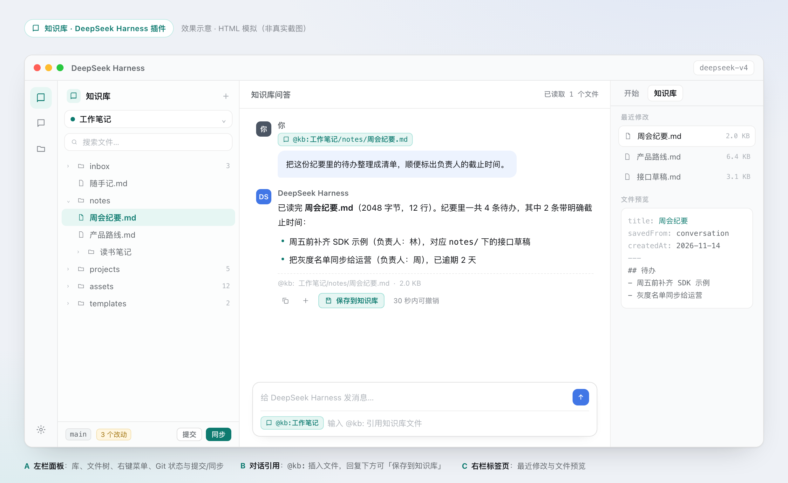

<p align="center"></p>

<h1 align="center">Knowledge Base · @local/dsh-knowledge-base</h1>

<p align="center"><b>Turn a local folder into a DeepSeek Harness knowledge base: browse on the left, preview on the right, cite with <code>@kb:</code> in chat, and save replies back with one click.</b></p>

<div align="center">

[English](README.en.md) · [简体中文](README.md) · [Preview](#preview) · [Install](#install) · [GitHub](https://github.com/Sunshine334419520/dsh-knowledge)


</div>

> A community plugin for DeepSeek Harness. Not an official DeepSeek product.

## Preview



> Mock-up (HTML render, not a live screenshot): A the left panel · B citation and "Save to knowledge base" · C the right-pane browser.

## Features

- **A library is just a folder**: a plain directory plus five seed areas (`inbox` / `notes` / `projects` / `assets` / `templates`). No private format, and an existing folder can be adopted as-is.
- **Git records versions, it is not a gate**: creating a library runs `git init -b main`; the panel footer shows "N changes" and commits in one click, and syncs when a remote is configured.
- **Round trips in chat**: type `@kb:` to search names and body text, and the pick inserts `@kb:<library>/<path>`; "Save to knowledge base" under an assistant reply writes the body back with front-matter, undoable for 30 seconds.
- **Nine model tools**: `kb_list` / `kb_find` / `kb_read` / `kb_search` / `kb_write` / `kb_append` / `kb_create` / `kb_move` / `kb_delete`; writes must carry an `expectedHash` so nobody overwrites another edit.

### File preview

- **The right pane lists, DSH previews**: the right-pane knowledge base page browses directories; clicking a file opens a new tab in DSH's native document preview (same as the Files panel), so Markdown, code, tables, PDF and Office are rendered by DSH itself. Switching away and back keeps the directory and list position.
- **Main-panel preview**: the plugin's own Markdown renderer — a GFM subset with heading anchors, aligned tables, task lists, nested lists, quotes, fenced code (language label + copy), front-matter cards, images and relative links, plus lightweight syntax highlighting. DSH's Markdown component is not exposed as a public Client module (plugins are explicitly not allowed to import other Client packages), so the renderer is implemented locally against the same theme tokens and interaction.
- **Code / text**: line numbers, wrapping, copy-all, language label and syntax highlighting for 60+ extensions plus extensionless files such as `Dockerfile` and `Makefile`.
- **Images / audio / video**: fit-to-pane images with intrinsic-size toggle and open-in-window; native media players.
- **PDF**: embedded in the browser's built-in PDF viewer.
- **Office**: `docx` / `xlsx` / `pptx` are parsed on the Host (zip + XML, no LibreOffice) — Word to rich text, Excel to multi-sheet tables with headers, row numbers and sheet tabs, PowerPoint to per-slide text; legacy `doc` / `xls` / `ppt` get a clear message. Excel dates and custom number formats show their stored values.

## What it changes, what it leaves alone

| Changes | Leaves alone |
| --- | --- |
| A "Knowledge base" panel in the left sidebar and a tab in the right pane | Files stay plain Markdown and folders; uninstall the plugin and they still read |
| One `@kb:` citation source and one "Save to knowledge base" action in chat | No system dependencies, no background service, no model configuration touched |
| A `.kb/` folder inside the library (identity marker and trash) | `.kb/` is git-ignored by the library, so it never lands in your repository |

## Install

### Command line

```bash
dsh plugin --profile desktop add github:Sunshine334419520/dsh-knowledge
```

Replace `desktop` with the profile you actually use. Reload the page (restart the desktop app) and the "Knowledge base" panel appears in the left sidebar.

### From source

```bash
git clone https://github.com/Sunshine334419520/dsh-knowledge.git
cd dsh-knowledge
dsh plugin --profile desktop add "$PWD"
```

There is no build step: edit `client.js` and reload the page; edit `index.js` or `lib/` and restart the app.

## Usage

1. Click **+** in the left "Knowledge base" panel, enter a name and a **parent folder** (optionally a cloud Git URL). With a remote, the library folder becomes `<parent>/<repo name>` (editable); without one the library lives inside the parent. Missing folders are created; an empty folder is initialized in place; a non-empty folder that is not a library is refused unless you opt into adopting it under Advanced; a remote that already has content is cloned instead of starting a fresh history.
2. Organize with **New document / New folder / Upload file**; the file context menu renames, deletes, and copies citations.
3. Type `@kb:` in the composer, pick from the search results, and the message gets `@kb:工作笔记/notes/周会话纪要.md`.
4. Click **Save to knowledge base** under an assistant reply, pick the library and relative path; the body is written with front-matter and can be undone for 30 seconds.
5. To delete a library, use the trash button in the panel header. By default it only drops the entry (folder, `.kb/` and Git history stay, and you can add it back later); tick "also delete the local folder" to really remove it, which cannot be undone.
6. Watch Git status in the panel footer: **Commit** is local only, **Sync** runs commit → merge remote → push. If the cloud was never set up (no token, offline, remote not created yet) the header shows **Cloud not initialized**; click it to run the first push.

> Binary files (PDF, images, audio, video) open and download but have no text preview. Deleted files move to `.kb/trash/<timestamp>/` and disappear from the tree.

## Settings

| Item | Default | Notes |
| --- | --- | --- |
| Library registry | `<DSH_PROFILE_DIR>/knowledge-base/libraries.json` | Library folders, ids and remotes; removing a library only drops the entry unless you also delete files |
| Library marker | `<library>/.kb/config.json` | `id` / `name` / `remote` / `createdAt`; a moved folder is still recognized |
| Trash | `<library>/.kb/trash/<timestamp>/` | Deletes move files rather than erase them; the trash stays local and is never committed |
| `.kb/` in Git | no | The whole `.kb/` folder is git-ignored at the library root; libraries cloned from older versions get it removed from the Git index at creation time |
| `debug` | off | Turns on host-side error and timing logs in the console |

## Compatibility and limits

- Hosts: DSH desktop (macOS / Windows) and the browser build; Git 2.x.
- A single file reads up to 2 MiB and uploads up to 32 MiB; anything larger can only be downloaded.
- Tokens for private HTTPS remotes are looked up in order: the DSH credential service (`DSH_KB_GITHUB_TOKEN` / `DSH_KB_GITLAB_TOKEN` / `DSH_KB_GIT_TOKEN`), then environment variables (`GITHUB_TOKEN`, `GH_TOKEN`, `GITLAB_TOKEN`, …). Tokens never appear in the remote URL or on a command line; SSH remotes use your local ssh configuration.
- Creation has two paths: an empty remote is initialized locally and pushed (branch fixed to `main`); a remote with content is cloned into `<parent>/.kb-staging-*` first and then moved into place, keeping the remote's history and default branch. An unreachable remote falls back to a local-only library, and "Cloud not initialized" pushes it later.
- Tokens can be saved right in the New library dialog (stored in the DSH credential service) and are verified with `git ls-remote` before saving; read-only access is reported as "readable but cannot push".
- Windows has no usable `sh`: `GIT_ASKPASS` points at a pure-cmd `lib/askpass.bat` with no Node or PATH dependency; macOS / Linux use `lib/askpass.sh`. Line endings are pinned by `.gitattributes` (`.sh` must stay LF, `.bat` is stored verbatim as CRLF) so a Windows checkout cannot break the scripts. Credentials also preset `credential.username`, leaving only the password prompt, so localized git prompts do not matter.
- Sync never rebases: new remote commits are merged, unrelated histories are refused unless you explicitly allow them, and conflicts trigger an automatic `merge --abort` that leaves the working tree clean.
- The tree renders in one pass without pagination; libraries with tens of thousands of files get noticeably slower.

## Troubleshooting

| Symptom | Fix |
| --- | --- |
| No "Knowledge base" panel | Check the package is in the profile's `dsh.profile.bundles`, run `dsh plugin --profile desktop add …`, then reload the page |
| "This library has no Git repository" | "Track versions with Git" was unchecked at creation; recreate the library, or run `git init -b main` inside it |
| Sync reports an authentication failure | Private remotes need a token: set `GITHUB_TOKEN` or the matching `DSH_KB_*`; never put a password in an HTTPS URL |
| The tree did not change after saving | Reload the panel; if the file is gone you just hit "Undo", so look in `.kb/trash/` |

## Development

```bash
git clone https://github.com/Sunshine334419520/dsh-knowledge.git
cd dsh-knowledge
dsh plugin --profile desktop add "$PWD"
```

- No build step. `client.js` is a browser module; `index.js` and `lib/*.mjs` are Node ESM.
- `index.js` registers HTTP routes, the nine model tools and the prompt section; `lib/api.mjs` implements the routes; `lib/store.mjs` owns the registry and file I/O; `lib/git.mjs` wraps Git; `lib/paths.mjs` parses remotes and cleans folder names; `lib/credentials.mjs` reads and masks tokens; `lib/askpass.sh` is the GIT_ASKPASS shim; `client.js` is the panel and interaction layer. Tests: `node tests/run.mjs` (Git flows) and `node tests/api.mjs` (HTTP routes).

## License

MIT, see [LICENSE](https://github.com/Sunshine334419520/dsh-knowledge/blob/main/LICENSE).

## Files

```
dsh-knowledge/
├── package.json        # bundle manifest: exports / dsh.bundle / dsh.client / files
├── cordis.patch.yml    # loader row (id: knowledge-base)
├── index.js            # host half: routes, model tools, prompt
├── lib/
│   ├── api.mjs         # /api/kb/* route implementations
│   ├── store.mjs       # registry, file I/O, search, sync
│   ├── git.mjs         # Git wrapper and error classification
│   ├── paths.mjs       # remote URL parsing, safe directory names
│   ├── credentials.mjs # token lookup and redaction
│   ├── askpass.sh      # GIT_ASKPASS shim for macOS / Linux
│   └── askpass.bat     # GIT_ASKPASS shim for Windows (pure cmd, CRLF)
├── client.js           # client half: sidebar panel, @kb source, right pane, save action
├── locale/             # zh / en strings
├── docs/preview.png    # the figure above
├── tests/              # Node tests for creation, sync, credentials, routes
└── icon.svg
```