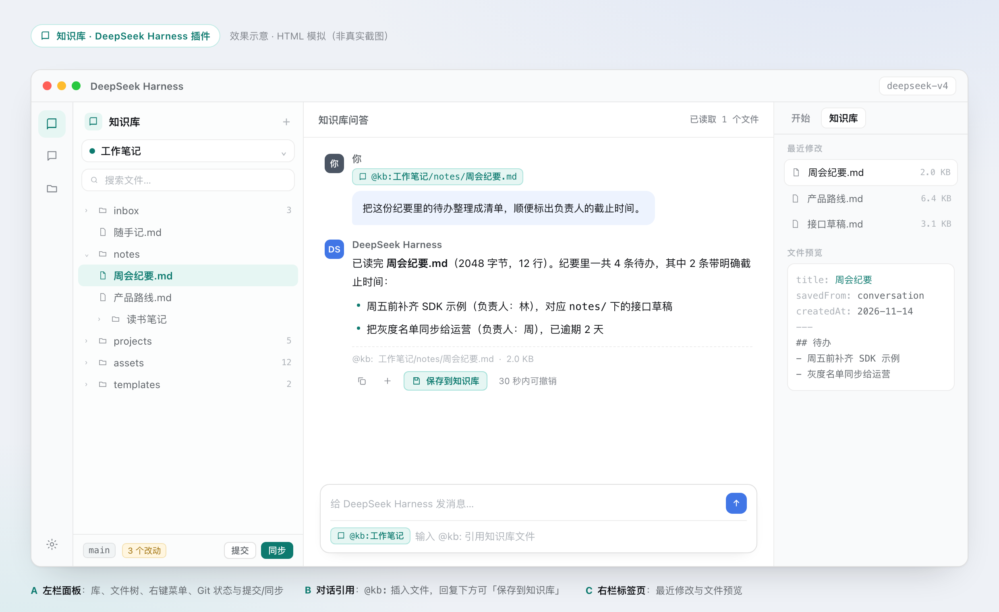

<p align="center"></p>

<h1 align="center">知识库 · @local/dsh-knowledge-base</h1>

<p align="center"><b>把本地目录变成 DeepSeek Harness 的知识库：左栏浏览、右栏预览，对话里用 <code>@kb:</code> 引用，回复一键回写。</b></p>

<div align="center">

[简体中文](README.md) · [English](README.en.md) · [预览](#预览) · [安装](#安装) · [GitHub](https://github.com/Sunshine334419520/dsh-knowledge)


</div>

> 面向 DeepSeek Harness 的社区插件，不是 DeepSeek 官方产品。

## 预览



> 效果示意（HTML 模拟，非真实截图）：A 左栏面板 · B 对话引用与「保存到知识库」 · C 右栏浏览页。

## 特性

- **库就是一个目录**：普通文件夹加五个种子分区（`inbox` / `notes` / `projects` / `assets` / `templates`），没有私有格式；已经有内容的目录可以直接接管。
- **Git 只做版本，不当门槛**：每次保存、新建、重命名、删除都在后台自动提交，用户不用想着「提交」；配了远端时只剩一个「同步」按钮。
- **对话里进出都有路**：输入 `@kb:` 搜文件名与正文，选中插入 `@kb:<库名>/<路径>`；助手回复下方「保存到知识库」把正文加 front-matter 写回，30 秒内可撤销。
- **九个模型工具**：`kb_list` / `kb_find` / `kb_read` / `kb_search` / `kb_write` / `kb_append` / `kb_create` / `kb_move` / `kb_delete`；写入必须带 `expectedHash`，避免覆盖别人的改动。

### 文件预览

- **右栏只做列表**：右栏的知识库页负责浏览目录；点击文件用 DSH 原生文档预览新开一个标签页（与文件面板一致），Markdown、代码、表格、PDF、Office 都由 DSH 自己渲染。切走再切回知识库标签，目录位置和列表保持不变。
- **主面板预览**：使用插件自带的 Markdown 渲染器——GFM 子集（标题锚点、表格对齐、任务列表、嵌套列表、引用、代码块语言标签 + 复制、front-matter 卡片、图片与相对链接），配轻量语法高亮。DSH 的 Markdown 组件没有作为公共 Client 模块暴露（框架明确不允许插件 import 其它 Client 包），所以按同样的交互和主题 token 自实现。
- **代码 / 文本**：行号、自动换行、全文复制、语言标签与语法高亮，覆盖 60+ 种扩展名与 `Dockerfile` / `Makefile` 等无扩展名文件。
- **图片 / 音视频**：图片适应窗口、点击查看原始大小、新窗口打开；音频与视频用原生播放器。
- **PDF**：浏览器内置 PDF 查看器内嵌预览。
- **Office**：`docx` / `xlsx` / `pptx` 在宿主侧直接解析（zip + XML，不依赖 LibreOffice）——Word 转富文本、Excel 转多工作表表格（表头/行号/工作表切换）、PPT 转分页文本；旧版 `doc` / `xls` / `ppt` 给出明确提示。Excel 日期与自定义数字格式按原始值显示。

## 它改变什么，不改变什么

| 改变 | 不改变 |
| --- | --- |
| 左栏多一个「知识库」面板，右栏多一个「知识库」标签页 | 文件仍是普通 Markdown 与目录结构，卸掉插件照常读 |
| 对话区多一个 `@kb:` 引用源和一个「保存到知识库」动作 | 不加系统依赖、不起后台服务、不动模型配置 |
| 库目录里多一个 `.kb/`（身份标记与回收站） | `.kb/` 被库内 `.gitignore` 排除，不会提交进你的仓库 |

## 安装

### 命令行

```bash
dsh plugin --profile desktop add github:Sunshine334419520/dsh-knowledge
```

把 `desktop` 换成你实际使用的 profile 名。装完刷新页面（桌面版重启应用），左栏就会出现「知识库」面板。

### 从源码

```bash
git clone https://github.com/Sunshine334419520/dsh-knowledge.git
cd dsh-knowledge
dsh plugin --profile desktop add "$PWD"
```

没有构建步骤：改 `client.js` 刷新页面生效，改 `index.js` 与 `lib/` 需要重启应用。

## 使用

1. 左栏「知识库」面板点 **+**，填名称与**父目录**（可选填云端 Git 地址）。有远端时库目录自动取「父目录/仓库名」，也可以手改；没有远端就直接在父目录里建库。目录不存在会创建；空目录就地初始化；已有内容但还不是知识库的目录默认拒绝，高级选项里可以接管或允许合并无关历史；远端已有内容时自动克隆，而不是凭空新建一段历史。
2. 用 **新建文档 / 新建文件夹 / 上传文件** 组织内容；文件右键可重命名、删除、复制引用。
3. 在输入框敲 `@kb:`，从搜索结果里选文件，消息中会插入 `@kb:工作笔记/notes/周会话纪要.md`。
4. 助手回复下方点 **保存到知识库**，选库与相对路径；正文会带 front-matter 写入，30 秒内点「撤销」可撤回。
5. 要删库：面板右上角垃圾桶按钮。默认只从列表移除（文件夹、`.kb/` 与 Git 历史都保留，之后还能再加回来）；勾上「同时删除本地文件夹」才真删，且不可恢复。
6. 面板底部看 Git 状态：改动已自动提交，**同步** 按钮依次做 提交 → 拉取合并 → 推送，按钮会转圈，完成后弹出「已同步 / 已是最新」，失败会写明卡在哪一步。建库时没连上云端（没令牌、断网、远端还没建）会显示 **云端未初始化**，点一下补做首推。

> 二进制文件（PDF、图片、音视频）可以打开与下载，但没有文本预览。删除的文件进 `.kb/trash/<时间戳>/`，文件树里看不到。

## 设置

| 项 | 默认 | 说明 |
| --- | --- | --- |
| 库注册表 | `<DSH_PROFILE_DIR>/knowledge-base/libraries.json` | 记录的库目录、id 与远端地址；删库只摘注册表，可选连文件一起删 |
| 库身份标记 | `<库>/.kb/config.json` | `id` / `name` / `remote` / `createdAt`；目录被移动后仍能认出是同一个库 |
| 回收站 | `<库>/.kb/trash/<时间戳>/` | 删除是移动，不是抹掉；回收站只在本机，不进版本库 |
| `.kb/` 是否入库 | 否 | 整个 `.kb/` 写进库根 `.gitignore`；从旧版本克隆下来的库，建库时会把它从 Git 索引里摘掉 |
| `debug` | 关闭 | 打开后宿主半在控制台打印错误与耗时 |

## 兼容与限制

- 宿主：DSH 桌面版（macOS / Windows）与浏览器版；Git 2.x。
- 单文件读取上限 2 MiB，上传上限 32 MiB；超出后只能下载，不能在线编辑。
- 私有 HTTPS 仓库的令牌按顺序查找：DSH 凭据服务（`DSH_KB_GITHUB_TOKEN` / `DSH_KB_GITLAB_TOKEN` / `DSH_KB_GIT_TOKEN`）→ 环境变量（`GITHUB_TOKEN`、`GH_TOKEN`、`GITLAB_TOKEN` 等）。令牌不进 remote URL、不进命令行参数；SSH 地址直接用本机 ssh 配置。
- 建库按远端状态分两路：远端为空 → 本地初始化并首推（分支固定 `main`）；远端已有内容 → 先克隆到 `<父目录>/.kb-staging-*` 再落位，保留远端历史与默认分支。远端探不通时只建本地库，之后用「云端未初始化」补推。
- 令牌可以在「新建知识库」对话框里直接保存（写入 DSH 凭据服务），保存前先用 `git ls-remote` 验证；只有读权限时会提示"可读但推不上去"。
- Windows 上没有可用的 `sh`：`GIT_ASKPASS` 改走纯 cmd 的 `lib/askpass.bat`，不依赖 node，也不依赖 PATH；macOS / Linux 用 `lib/askpass.sh`。换行符由 `.gitattributes` 固定（`.sh` 必须是 LF，`.bat` 按原样存 CRLF），避免 Windows 检出后脚本失效。凭据同时用 `credential.username` 预置用户名，只剩密码提示，不受 git 提示语本地化影响。
- 同步不做 rebase：远端有新提交时走合并；两边历史互不相关时默认拒绝合并，需要显式允许；冲突时自动 `merge --abort`，工作区保持干净。
- 文件树一次渲染一整棵，没有分页；几万个文件的库会明显变慢。

## 排错

| 症状 | 修法 |
| --- | --- |
| 左栏没有「知识库」 | 确认 profile 的 `dsh.profile.bundles` 里有这个包，再 `dsh plugin --profile desktop add …` 后刷新页面 |
| 「这个库没有 Git 仓库」 | 建库时没勾「用 Git 管理版本」；删除重建，或在库目录手动 `git init -b main` |
| 同步报鉴权失败 | 私有仓库要令牌：设置 `GITHUB_TOKEN` 或对应的 `DSH_KB_*`；HTTPS 地址里不要带密码 |
| 保存后文件树没变 | 点面板刷新；找不到文件说明刚点过「撤销」，去 `.kb/trash/` 里找 |

## 开发

```bash
git clone https://github.com/Sunshine334419520/dsh-knowledge.git
cd dsh-knowledge
dsh plugin --profile desktop add "$PWD"
```

- 无构建步骤。`client.js` 是浏览器模块，`index.js` 与 `lib/*.mjs` 是 Node ESM。
- `index.js` 注册 HTTP 路由、九个模型工具与提示词；`lib/api.mjs` 是路由实现；`lib/store.mjs` 管注册表与文件读写；`lib/git.mjs` 封装 Git 命令；`client.js` 是面板与交互。

## 许可证

MIT，见 [LICENSE](https://github.com/Sunshine334419520/dsh-knowledge/blob/main/LICENSE)。

## 文件清单

```
dsh-knowledge/
├── package.json        # bundle 声明：exports / dsh.bundle / dsh.client / files
├── cordis.patch.yml    # Loader 插入行（id: knowledge-base）
├── index.js            # 宿主半：路由、模型工具、提示词
├── lib/
│   ├── api.mjs         # /api/kb/* 路由实现
│   ├── store.mjs       # 注册表、文件读写、搜索、同步
│   ├── git.mjs         # Git 命令封装与错误归类
│   ├── paths.mjs       # 远端地址解析、目录名清洗
│   ├── credentials.mjs # 访问令牌的读取与脱敏
│   ├── askpass.sh      # macOS / Linux 的 GIT_ASKPASS 垫片
│   └── askpass.bat     # Windows 的 GIT_ASKPASS 垫片（纯 cmd，CRLF）
├── client.js           # 客户端半：左栏面板、@kb 源、右栏页、保存动作
├── locale/             # zh / en 文案
├── docs/preview.png    # 本页示意图
├── tests/              # 建库 / 同步 / 凭据 / 路由的 Node 测试
└── icon.svg
```